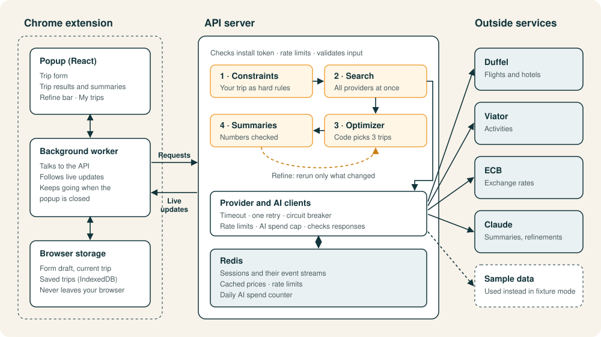
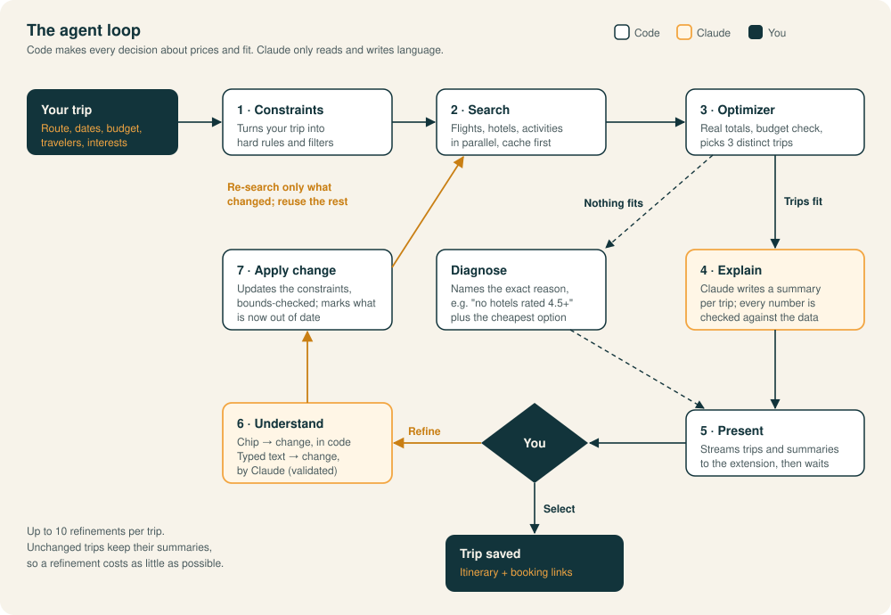

#  Travellite

A Chrome extension that plans a whole trip — flight, hotel and activities — within one total budget.

Tell it where you're flying from, where you want to go, your dates and your budget. It searches
real flights, hotels and activities, then shows up to three complete trips that fit:

- **Best value**: the most trip for the money
- **Best location**: a hotel closer to the center
- **Upgrade**: a better hotel or flight, if the budget allows

Each trip comes with a short summary explaining why it was picked. If nothing fits, Travellite
tells you exactly why, for example "No hotels rated 4.5+ (the highest rated is 4.2)" or the
cheapest flight + hotel for your dates, so you know what to change.

Not quite right? Refine it with one click ("Cheaper hotel", "Fewer stops", "A day earlier") or
in your own words ("hotels under $150 a night"), up to 10 times. When you pick a trip, it's saved
under **My trips** with booking links.

## Run it

You need Node 22.12+, Docker and Chrome.

```bash
npm install
cp .env.example .env              # set INSTALL_TOKEN_KEYS to a random secret (32+ chars)
docker compose up -d redis        # Redis on localhost:6379
npm run dev                       # API on http://localhost:3000
npm run build -w @travellite/extension
```

Then in Chrome: open `chrome://extensions`, turn on **Developer mode**, click **Load unpacked**
and choose `apps/extension/dist`. Pin the Travellite icon and start planning.

Out of the box it uses recorded sample data, so no provider accounts are needed.

### Settings (`.env`)

| Setting                                          | What it does                                                                                                                  |
| ------------------------------------------------ | ----------------------------------------------------------------------------------------------------------------------------- |
| `ANTHROPIC_API_KEY`                              | Writes the trip summaries and understands typed refinements. Without it, summaries are simpler and typed refinements are off. |
| `PROVIDER_MODE`                                  | `fixture` (default) uses sample data; `live` makes every provider live.                                                       |
| `FLIGHTS_MODE`, `HOTELS_MODE`, `ACTIVITIES_MODE` | With `PROVIDER_MODE=fixture`, set any of these to `live` to use real data for just that part.                                 |
| `DUFFEL_ACCESS_TOKEN`                            | Needed for live flights or hotels ([Duffel](https://duffel.com/docs); hotel search must be enabled on the account).           |
| `VIATOR_API_KEY`                                 | Needed for live activities ([Viator Partner API](https://docs.viator.com/partner-api/)).                                      |

Restart `npm run dev` after changing `.env`.

## How it works



### Agent loop



The optimizer is plain code: it adds up real totals and keeps only trips within your budget and
filters. Claude writes the summaries and turns typed refinements into changes, and every number
it writes is checked against the real prices. You can close the popup at any point; the
background worker keeps following the trip and picks up where it left off.

**Reliability.** Each provider call has a timeout, one retry and a circuit breaker. Prices are
cached so repeated searches are fast. If activities fail, you still get trips without them. If
flights or hotels fail, you get a message naming the exact cause.

**Privacy.** Saved trips stay in your browser. The server keeps a trip only while you're planning
it.

## Project layout

```
travel-planner-agent/
├── apps/
│   ├── extension/             Chrome extension (React, Vite, Manifest V3)
│   │   ├── src/popup/         What you see: trip form, results, refine bar, My trips
│   │   ├── src/worker/        Background worker: API calls, live updates, saved trips
│   │   └── icons/             App icon source
│   └── api/                   API server (Node, Fastify, Redis)
│       ├── src/routes/        HTTP endpoints
│       ├── src/orchestrator/  Runs each planning session step by step
│       ├── src/search/        Parallel, cached search
│       ├── src/providers/     Duffel, Viator and exchange-rate clients
│       ├── src/core/          Constraints, optimizer, refinements, error messages
│       └── src/llm/           Claude summaries and refinement parsing
├── packages/
│   └── schema/                Data types shared by the API and the extension
├── fixtures/                  Sample data for running without provider accounts
├── docs/                      Diagrams used in this README
└── Specs/                     Requirements and detailed design
```

## Development

```bash
npm run ci        # lint, format, typecheck, tests and build (needs Redis)
```

More detail: `Specs/design.md` covers the architecture, and `fixtures/README.md` covers
recording and sample data.
